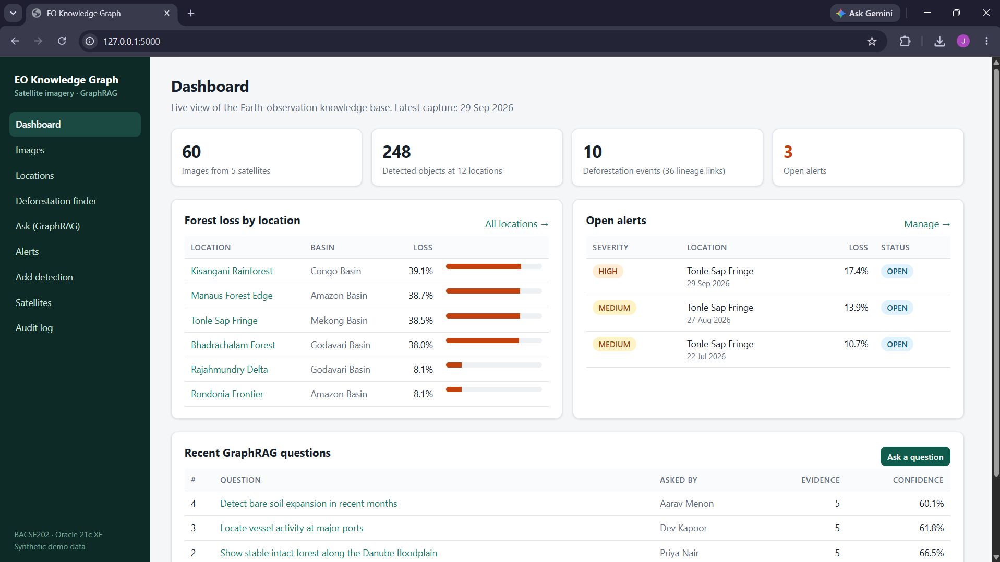
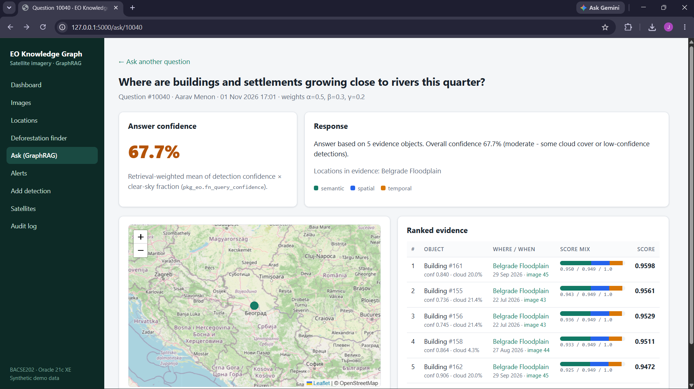

# Satellite Imagery Knowledge Graph: GraphRAG for Earth Observation Data

**BACSE202 – Database Management Systems · Fall Semester 2026–27 · Faculty: Dr. S. Geetha**

## Problem statement
Earth-observation (EO) metadata is fragmented. Image timestamps, footprints, cloud cover, sensor details and AI-detected objects are stored separately, with no link between observations of the same place over time. Analysts therefore cannot easily answer connected questions such as *"Which images show rapid deforestation near river basins in Q3, and how trustworthy is that evidence?"*

## Abstract
This project builds a database-backed application that unifies EO metadata in a normalised 15-table Oracle schema. It links satellites, sensors, images, locations, river basins and AI-detected objects, and introduces three ideas:
1. **Temporal lineage (EVOLVED_FROM):** the same forest patch is tracked across images, so loss can be measured and explained step by step.
2. **Tunable hybrid retrieval:** α·semantic + β·spatial + γ·temporal.
3. **Confidence propagation:** detection confidence and cloud cover feed into a trust score for each answer.

A Flask web application exposes nine end-to-end features. PL/SQL packages and triggers enforce the business rules. A Neo4j graph extension (DA3) supports native graph, spatial and vector queries. All data is synthetic.

## Team
| Name | Register number |
|---|---|
| Joshwa D Y | 25BCE5176 |
| Nallazhahu M | 25BCE5203 |
| Akshay V | 25BCE5116 |

**GitHub:** https://github.com/WorksByJoshhhh/satellite-eo-knowledge-graph · **Demo video (YouTube, unlisted):** https://youtu.be/2usdhUZrZ2Q · **Report:** `report/DBMS_Project_Report.pdf` · **Slides:** `presentation/DBMS_Project_Presentation.pptx`

## Features (all connected to the database)
| # | Feature | Database work behind it |
|---|---|---|
| 1 | **Dashboard** | KPI scalar subqueries, `fn_forest_loss_pct` ranking, open alerts |
| 2 | **Image catalogue** (search + detail) | view `v_image_summary`, filters with bind variables, detected objects, spectral indices |
| 3 | **Location profile** | tree-cover timeline chart, `EVOLVED_FROM` lineage chain, change history |
| 4 | **Deforestation finder** + map | `v_forest_change` + `fn_haversine_km`, evidence-trust score, linked alerts |
| 5 | **Change analysis & alerts** | calls `pkg_eo.compute_changes` / `pkg_eo.raise_alerts`; assign/resolve (UPDATE + trigger `trg_alert_resolve`) |
| 6 | **Ask (GraphRAG)** | hybrid retrieval; INSERT into `QUERY_LOG` + `QUERY_EVIDENCE` in one transaction; `pkg_eo.finalize_query` computes answer confidence |
| 7 | **Add detection** | validated INSERT via `pkg_eo.add_detection` (SAVEPOINT/ROLLBACK); audit row written by trigger |
| 8 | **Satellites CRUD** | INSERT / UPDATE / DELETE with UNIQUE, CHECK and FK error handling |
| 9 | **Audit log** | rows produced only by triggers (`trg_obj_audit`, `trg_alert_stmt_audit`) |

Validation happens twice: in the app (`src/services.py`) and in the database (constraints, triggers, package). Every Oracle error is shown as a readable message, for example ORA-00001 becomes "A satellite with this name already exists."

## Technology stack
- **Database:** Oracle Database 21c Express Edition. The SQL and PL/SQL scripts also work on 19c and later.
- **Application:** Python 3.10+, Flask 3, python-oracledb (thin mode, so no Oracle Client install is needed), Jinja2 templates.
- **Front end:** HTML/CSS, Leaflet 1.9.4 (maps) and Chart.js 4.4.1 (charts), both loaded from a CDN, so maps and charts need internet.
- **Graph extension (DA3):** Neo4j 2026.10 (Cypher 25) with point and vector indexes. See `neo4j/`.
- **Tools:** Oracle SQL Developer, Neo4j Desktop, pytest.

## Repository structure
```
satellite-eo-knowledge-graph/
├── README.md
├── requirements.txt, .env.example, .gitignore
├── database/
│   ├── schema.sql          15 tables, constraints, indexes, 2 views
│   ├── sample_data.sql     synthetic data (~490 rows)
│   ├── plsql.sql           3 functions, package pkg_eo, 4 triggers
│   ├── run_procedures.sql  builds lineage, alerts and confidences
│   ├── queries.sql         20 SQL queries (joins, aggregates, subqueries, views, windows, CONNECT BY, JSON, transactions)
│   └── extras.sql          ALTER, GRANT/REVOKE, explicit cursors, user-defined exception, statement trigger
├── src/                    Flask application (app.py, repo.py, services.py, db.py, config.py, templates/, static/)
├── tests/                  unit, UI and live-database tests + TEST_CASES.md + expected_results.txt
├── neo4j/                  DA3 graph extension: Cypher scripts, CSV import files, graph model diagram
├── scripts/generate_data.py  deterministic generator for the SQL data and the Neo4j CSVs
├── docs/                   ER diagram and relational schema (PNG + source), DA1/DA2/DA3 report content, study guides
├── screenshots/            application and database evidence
├── report/                 DBMS_Project_Report.pdf
└── presentation/           DBMS_Project_Presentation.pptx
```

## Setup and run

### 1. Create the database objects (Oracle SQL Developer)
1. Connect as a user with these privileges: `CREATE SESSION, CREATE TABLE, CREATE VIEW, CREATE PROCEDURE, CREATE TRIGGER, CREATE SEQUENCE` and quota on USERS. As SYS, run:
   `GRANT CREATE VIEW, CREATE PROCEDURE, CREATE TRIGGER, CREATE SEQUENCE TO <user>;`
2. Open each file and run it as a script (F5), in this order:
   `schema.sql → sample_data.sql → plsql.sql → run_procedures.sql → queries.sql → extras.sql`
3. Check the results: `run_procedures.sql` prints *36 lineage links*, *4 new alerts* and confidences *61.2 / 66.6 / 61.8 / 60.1 %*. See `tests/expected_results.txt`.

### 2. Configure and run the application
```bash
python -m venv venv
venv\Scripts\activate            # Windows   (macOS/Linux: source venv/bin/activate)
pip install -r requirements.txt
copy .env.example .env           # then edit .env with your Oracle user, password and DSN
cd src
python app.py
```
Open **http://127.0.0.1:5000**. The `/health` route returns the detected-object count if the connection works.

### 3. Run the tests
```bash
python -m pytest -v                         # unit + UI tests (no database needed)
python -m pytest tests/test_integration_db.py -v   # live Oracle tests (uses .env)
```

### 4. Neo4j extension (optional, DA3)
Copy `neo4j/import/*.csv` into the Neo4j instance's import folder. Then run `01_constraints_indexes.cypher → 02_load.cypher → 03_queries.cypher → 04_crud.cypher`. `05_graph_views.cypher` returns graph pictures.

## Database design summary
**15 tables**, with every foreign key indexed:

| Table | Purpose | Key relationships |
|---|---|---|
| SATELLITE | orbiting platform | 1:N SENSOR |
| SENSOR | instrument; holds resolution | N:1 SATELLITE, 1:N IMAGE_FRAME |
| RIVER_BASIN | hydrological region with a river reference point | 1:N LOCATION (optional) |
| LOCATION | monitored place | N:1 RIVER_BASIN, 1:N IMAGE_FRAME |
| IMAGE_FRAME | one captured scene (time, cloud, embedding) | N:1 SENSOR, N:1 LOCATION |
| OBJECT_TYPE | lookup: building, vessel, tree coverage… | 1:N DETECTED_OBJECT |
| DETECTION_MODEL | AI model + version | 1:N DETECTED_OBJECT |
| DETECTED_OBJECT | object found in an image (bbox, confidence, embedding) | N:1 IMAGE_FRAME / OBJECT_TYPE / DETECTION_MODEL |
| OBJECT_CHANGE | **EVOLVED_FROM** lineage between two observations | 2 FKs to DETECTED_OBJECT |
| SPECTRAL_INDEX | NDVI / NDWI per image | N:1 IMAGE_FRAME |
| APP_USER | analysts | 1:N QUERY_LOG, 1:N ALERT |
| QUERY_LOG | natural-language question, weights, answer confidence | N:1 APP_USER |
| QUERY_EVIDENCE | associative entity: QUERY_LOG M:N DETECTED_OBJECT, with scores | 2 FKs |
| ALERT | raised for trustworthy losses | 1:1 OBJECT_CHANGE, N:1 APP_USER |
| AUDIT_LOG | written by triggers | none |

Constraints include PRIMARY KEY, FOREIGN KEY (CASCADE / SET NULL), UNIQUE, NOT NULL, CHECK (ranges, enumerations, `IS JSON`, bbox ordering) and trigger-enforced rules (no future captures; lineage links only at the same location and in time order). The schema is normalised to BCNF. Satellite and resolution are reached through SENSOR, and the basin through LOCATION, so no transitive dependencies remain.

**Sample data:** 5 satellites, 6 sensors, 5 basins, 12 locations, 60 images (5 dates, Apr–Sep 2026), 247 detected objects, 120 spectral indices, 4 users, 4 logged questions with 20 evidence rows. It is generated deterministically by `scripts/generate_data.py`. Four forest locations deforest rapidly, three lose forest slowly, and two are stable.

## Screenshots
`screenshots/` holds the evidence, named by source:
- `oracle_00`–`oracle_14`: SQL Developer connection, schema creation, sample data, PL/SQL compilation and `run_procedures.sql` output (36 lineage links, 4 alerts, confidences)
- `oracle_q01`–`oracle_q19`: results of every query in `queries.sql` (e.g. `oracle_q10_flagship_query.png`)
- `oracle_e1`–`oracle_e9`: `extras.sql` (ALTER, GRANT/REVOKE, cursors, exceptions, statement trigger, cascade delete, data dictionary)
- `neo4j_*`: constraints, CSV load and counts, G1–G14 queries, C1–C9 CRUD steps and V-series graph views
- `tests_pytest_*`: automated test runs (latest: 91 passed in 3.32 s)
- `app_01`–`app_08`: the running web application (dashboard, Kisangani location profile, deforestation finder, a new GraphRAG question with 67.7 % confidence, blocked satellite delete)
- `existing_global_nature_watch.png`: an existing system reviewed in the report




## Testing
`tests/TEST_CASES.md` lists 30 test cases with expected and actual results.
- **Automated:** 58 unit and UI tests (validation, scoring, error translation, every page and form path), plus 12 live-database tests (CRUD round-trip, duplicate/CHECK/FK violations, package errors, triggers, GraphRAG end-to-end, flagship query = 10 rows). Latest result on the project laptop: **91 passed in 3.32 s** (`screenshots/tests_pytest_91_passed.png`).
- `tests/test_integration_app.py` adds live UI tests through the Flask test client (skipped automatically when Oracle is not configured).

## Known limitations
- The data is synthetic. Embeddings are 8-dimensional demo vectors; production would use real image embeddings (for example SatCLIP, 512-d).
- Concept search uses data-driven prototype vectors (the centroid of labelled examples), not a free-text language model.
- "Near a river" is measured to one reference point per basin, not to a river polygon. Oracle XE is used without Oracle Spatial.
- The lineage model assumes one tree-coverage patch per image (the app enforces this).
- Maps and charts load from a CDN and need internet.
- There is no login system. Users are selected from APP_USER for the demo.

## References
See `report/DBMS_Project_Report.pdf` (IEEE style). Principal references: Oracle Database 21c PL/SQL Language Reference; python-oracledb documentation; Flask documentation; Neo4j Cypher Manual (vector and point indexes); Copernicus Sentinel-2 mission documentation; Global Forest Watch.

## License
MIT License, see `LICENSE`.
